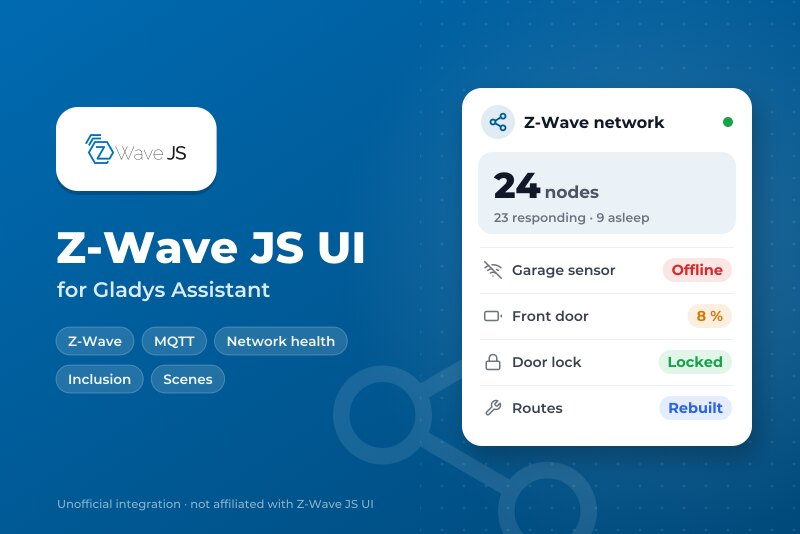
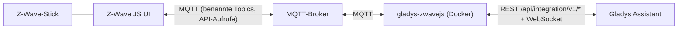
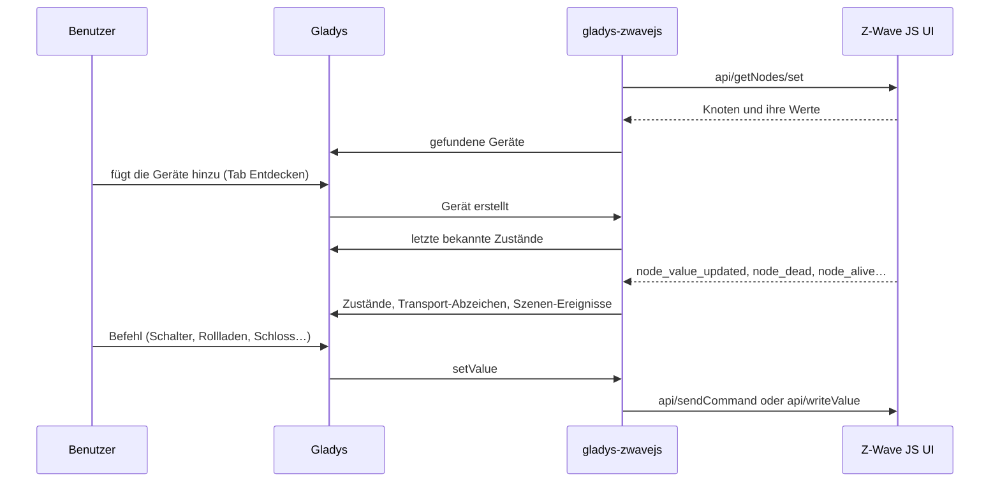
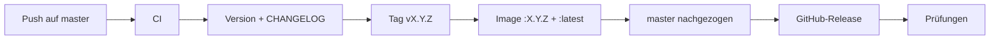

# Gladys Z-Wave JS UI

[English](README.md) | [Français](README.fr.md) | **Deutsch** | [Español](README.es.md)

[](LICENSE)
[](https://github.com/William-De71/gladys-zwavejs/releases)
[](https://github.com/William-De71/gladys-zwavejs/actions/workflows/release.yml)
[](https://gladysassistant.com)



Ihr [Z-Wave JS UI](https://zwave-js.github.io/zwave-js-ui/)-Netz in Gladys Assistant, über MQTT: Schalter, Dimmer, Rollläden, Sensoren, Thermostate, Heizkörper mit Steuerdraht (fil pilote), Farblichter, Schlösser, Sirenen und Garagentore, dazu ein Widget für den Zustand des Netzes und Szenen, um Knoten anzupingen, zu reparieren und aufzunehmen.

> **Ein Fork und eine persönliche Integration.** Dieses Repository ist ein Fork von [sescandell/gladys-zwavejs](https://github.com/sescandell/gladys-zwavejs) von Stéphane Escandell (Apache-2.0), das in eigenem Rhythmus veröffentlicht wird; die Ergänzungen sind unten mit „Fork“ gekennzeichnet. Es ist nicht im Gladys-Store (das Repository trägt absichtlich nicht das Topic `gladys-assistant-integration`): Installieren Sie es über die URL dieses Repositorys.

Benutzerdokumentation: [`docs/de.md`](docs/de.md) · [`docs/en.md`](docs/en.md). Die Integration erweitern: [`AGENTS.md`](AGENTS.md) (auf Englisch).

## Funktionen

- **Geräte, aus den Z-Wave-Command-Classes aufgebaut**: Binär- und Mehrstufenschalter (Dimmer, Rollläden, Steuerdraht des Qubino Flush Pilot), Binär- / Alarm- / Mehrstufensensoren, Benachrichtigungen, Zähler, Central-Scene-Tasten, Batterien, Thermostate (Modus, Sollwerte, Betriebszustand).
- **Weitere Command Classes** (Fork): Farblichter (Color Switch), Türschlösser (Door Lock), Sirenen (Sound Switch), Garagentore und Einfahrtstore (Barrier Operator), Thermostat-Lüfter (Thermostat Fan Mode).
- **Dashboard-Widget „Z-Wave-Netz“** (Fork): Knoten, Knoten, die nicht antworten, schwache Batterien, schlafende Knoten, was Ihre Aufmerksamkeit braucht, und die Schaltflächen **Aktualisieren** / **Routen neu aufbauen**.
- **Szenen-Auslöser** (Fork): Ein Knoten antwortet nicht mehr, antwortet wieder, wird hinzugefügt.
- **Szenen-Aktionen** (Fork): einen Knoten anpingen, seine Werte neu lesen, die Routen eines Knotens oder des Netzes neu aufbauen, einen Konfigurationsparameter setzen, eine Inklusion oder Exklusion starten oder beenden.
- **Transport-Abzeichen** auf jedem Gerät: toter Knoten, Interview unvollständig.
- **Eins-zu-eins-Migration** vom eingebauten Gladys-Dienst: dieselben externen IDs, abgesichert durch den Golden-Test.

## Funktionsweise





Z-Wave JS UI verwaltet das Funkmodul und das Netz. Diese Integration übersetzt, was es veröffentlicht, in Gladys-Geräte, Gladys-Befehle zurück in Z-Wave-Befehle, und leitet einige Netzoperationen (Ping, Neuaufbau der Routen, Inklusion) aus den Szenen und dem Widget an es weiter. Sie implementiert bewusst keinen Teil von zwave-js neu.

### Transport

Nur `local`: Die Integration spricht mit Ihrem MQTT-Broker, nichts verlässt Ihr Netzwerk. Jedes Gerät trägt ein Transport-Abzeichen: **Nicht erreichbar**, wenn Z-Wave JS UI den Knoten als tot markiert, **Beeinträchtigt**, solange sein Interview nicht abgeschlossen ist.

### Projektaufbau

```
index.ts                        SDK-Start + Verdrahtung der Callbacks, keine Logik
src/
  config.ts                     Standardwerte, Broker und Topics
  types/zwave.ts                Formen der Nachrichten von Z-Wave JS UI
  zwave/
    ZwaveJsUiClient.ts          MQTT-Verbindung (idempotente Wiederverbindung)
    ZwaveApi.ts                 Anfrage / Antwort über die API von zwave-js-ui
    NodeRegistry.ts             Abbild des Netzes im Speicher
    topics.ts                   Topic-Baum + Abonnements
    stateValues.ts              Gladys-Zustände, die das SDK nicht exportiert
    commandClasses/             EIN MODUL PRO COMMAND CLASS
  mapping/
    DeviceMapper.ts             Knoten -> Geräte, Werte -> Zustände
    externalId.ts               Aufbau / Auswertung der externen IDs
    featureName.ts              lesbare Funktionsnamen
    quirks.ts                   Korrekturen pro Gerät, jede mit ihrem Grund
    transport.ts                Knotenstatus -> Transport-Abzeichen des Geräts
    clean.ts                    Normalisierung der Namen
  runtime/
    ZwaveIntegration.ts         die Integration selbst
    NetworkOperations.ts        die Szenen-Aktionen
    networkHealth.ts            Netzübersicht + Inhalt des Widgets
    StatePublisher.ts           Deduplizierung, Bündelung, Zusammenfassung, Budget
    TransportPublisher.ts       Transport-Abzeichen, nur Änderungen
    CommandDispatcher.ts        Gladys-Befehl -> MQTT-Nachricht
.github/scripts/release.mjs     Version, Changelog, Versionssprung (getestet in test/)
```

**Ein Modul pro Command Class.** Ein Modul vereint die drei Facetten jeder Eigenschaft: was sie als Gladys-Funktionen **bereitstellt**, wie ihre Werte **gelesen** werden (`fromZwave`) und wie sie **gesteuert** wird (`toZwave`); werden sie gemeinsam deklariert, können sie nicht auseinanderlaufen. Varianten, die nach der Geräteklasse gewählt werden, stehen in `byDeviceClass`: Ein Dimmer (`17-1`) und ein Rollladenmotor (`17-5/6/7`) sprechen beide Multilevel Switch, und `0` bedeutet beim einen AUS, beim anderen STOPP. Wenn sogar die Geräteklasse falsch ist, wählt `byProduct` eine Variante nach Produkt (ein Steuerdrahtmodul gibt sich als Dimmer aus). Eine Command Class hinzuzufügen bedeutet eine Datei und eine Zeile in `commandClasses/index.ts`.

**Veröffentlichung der Zustände.** Gladys akzeptiert 300 Zustände pro Minute und Integration, 100 pro Anfrage, und ein Z-Wave-Netz meldet schneller als das. `StatePublisher` verwirft die Zustände von Geräten, die der Benutzer nicht erstellt hat; verwirft einen Wert, der mit dem letzten identisch ist, allerdings nur für einige Minuten (niemals ein Ereignis wie einen Tastendruck); bündelt und fasst nur die `sampled`-Messwerte zusammen (ein Rollladen oder Dimmer behält jede Zwischenposition); und hält die Warteschlange zurück, statt das Budget zu überschreiten.

**Steuerung der Geräte.** Alles, was ein Befehl braucht, stammt aus der externen ID der Funktion, dem Command-Class-Modul und der Kategorie der Funktion, nie aus dem Knoten-Cache; so funktioniert ein Befehl direkt nach einem Neustart. Die externen IDs werden gespeichert:

```
Gerät    : ext:<selector>:<nodeId>
Funktion : ext:<selector>:<nodeId>:<endpoint>:<cc>:<property>[:<propertyKey>][:<featureName>]
```

## Geräte und Funktionen

| Command Class                   | Was Sie in Gladys erhalten                                   |
| ------------------------------- | ------------------------------------------------------------ |
| Binary Switch                   | Ein/Aus-Schalter                                             |
| Multilevel Switch (Dimmer)      | Helligkeit, Ein/Aus, „vorherigen Wert wiederherstellen“      |
| Multilevel Switch (Rollladen)   | Rollladenposition, öffnen/schließen/stoppen                  |
| Multilevel Switch (Steuerdraht) | Heizmodus: aus, Frostschutz, Eco, Komfort…                   |
| Binary Sensor / Alarm Sensor    | Bewegung, Rauch, CO, CO₂, Leck, Öffnung, Temperatur          |
| Notification                    | Tür-/Fensteröffnung, Rauchalarm, CO-Alarm                    |
| Multilevel Sensor               | Temperatur, Helligkeit, Leistung                             |
| Meter                           | Energie, Leistung, Spannung, Strom                           |
| Central Scene                   | Tastendrücke (einfach, doppelt, dreifach, halten, loslassen) |
| Battery                         | Ladestand und Anzeige für schwache Batterie                  |
| Thermostat Mode / Setpoint      | Modus; Sollwerte für Heizen, Kühlen und Energiesparen        |
| Thermostat Operating State      | Leerlauf, Heizen, Kühlen                                     |
| Thermostat Fan Mode (Fork)      | Lüfterstufe: Auto, niedrig, mittel, hoch, leise              |
| Color Switch (Fork)             | RGB-Farbe                                                    |
| Door Lock (Fork)                | verriegelt / entriegelt                                      |
| Sound Switch (Fork)             | Sirene ein/aus, eine pro Endpoint                            |
| Barrier Operator (Fork)         | Garagentor / Einfahrtstor: öffnen/schließen + Öffnungssensor |

Die Details (Steuerdraht, Thermostate, Schlösser, Garagentore) stehen in der [Benutzerdokumentation](docs/de.md).

## Szenen-Auslöser, Aktionen und Widget

| Auslöser     | Wann                                       | Variablen          |
| ------------ | ------------------------------------------ | ------------------ |
| `node_dead`  | Z-Wave JS UI markiert einen Knoten als tot | node_id, node_name |
| `node_alive` | ein toter Knoten ist wieder erreichbar     | node_id, node_name |
| `node_added` | ein Gerät wurde gerade aufgenommen         | node_id, node_name |

Die ersten beiden lassen sich auf ein Gerät beschränken.

| Aktion                     | Wirkung                                        | Ausgaben           |
| -------------------------- | ---------------------------------------------- | ------------------ |
| `ping_node`                | prüft, ob der Knoten antwortet                 | alive              |
| `refresh_values`           | fragt alle Werte des Knotens erneut ab         | completed          |
| `rebuild_node_routes`      | repariert den Weg eines Knotens zum Controller | completed, success |
| `rebuild_network_routes`   | startet den Neuaufbau der Routen aller Knoten  | started            |
| `set_config_parameter`     | schreibt einen Parameter (Nummer + Wert)       | completed, success |
| `start_inclusion`          | Inklusionsmodus (Standard oder unsicher)       | started            |
| `start_exclusion`          | Exklusionsmodus                                | started            |
| `stop_inclusion_exclusion` | beendet beide Modi                             | —                  |

Ein batteriebetriebener Knoten erhält eine Anfrage erst beim nächsten Aufwachen: Die Aktion antwortet dann `completed: false`, statt fehlzuschlagen, und die Anfrage bleibt in Z-Wave JS UI in der Warteschlange. Eine sichere S2-Inklusion verlangt die PIN des Geräts in Z-Wave JS UI.

Das Widget **Z-Wave-Netz** zeigt vier Zähler (Knoten, antworten nicht, schwache Batterien, schlafend), die Liste dessen, was Ihre Aufmerksamkeit braucht (seit wann stumm, Batteriestand, Interview unvollständig), und zwei Schaltflächen: **Aktualisieren** und **Routen neu aufbauen** (mit Bestätigung).

Beispiele:

- **Wenn ein Knoten nicht mehr antwortet** → mir „{{triggerEvent.data.node_name}} antwortet nicht mehr“ senden.
- **Jeden Sonntag um 3:00 Uhr** → die Routen des Netzes neu aufbauen.
- **Wenn ein Knoten hinzugefügt wird** → seinen Konfigurationsparameter 3 auf 1 setzen.

## Voraussetzungen

- Gladys Assistant **5.3.0** oder neuer. Ältere Instanzen können diese Version nicht installieren.
- [Z-Wave JS UI](https://zwave-js.github.io/zwave-js-ui/) mit aktiviertem MQTT-Gateway und ein MQTT-Broker, den beide erreichen.
- In Z-Wave JS UI, Abschnitt MQTT: **Name** `zwave-js-ui`, **Prefix** `zwave`. Abschnitt Gateway: **Named topics**, **Entire Z-Wave value Object**, und **Send Z-Wave events**, **Include Node info** sowie **Publish node details** aktiviert (Bildschirmfotos in der [Benutzerdokumentation](docs/de.md)).

## Installation

1. In Gladys: **Integrationen → Externe Integrationen → von einer Repository-URL installieren**, dann `https://github.com/William-De71/gladys-zwavejs`.
2. Entwicklermodus: Bauen Sie das Image auf dem Gladys-Rechner (`docker build -t gladys-zwavejs .`) und installieren Sie es über „Entwicklermodus: von einem Docker-Image installieren“.

Sie kommen vom eingebauten Z-Wave-JS-UI-Dienst von Gladys: Die externen IDs sind dieselben, siehe „Migration“ in der [Benutzerdokumentation](docs/de.md).

## Konfiguration

| Feld                 | Standard | Zweck                             |
| -------------------- | -------- | --------------------------------- |
| URL des MQTT-Brokers | leer     | `mqtt://host:1883`, mit Protokoll |
| MQTT-Benutzer        | leer     | leer für einen anonymen Broker    |
| MQTT-Passwort        | leer     | als Geheimnis gespeichert         |

Die Schaltfläche **Verbindung testen** zeigt, ob der Broker antwortet und wie viele Knoten bekannt sind; **Berechnete Geräte protokollieren** schreibt für einen Fehlerbericht ins Protokoll, was an Gladys gesendet wird.

## Verwendung

1. Speichern Sie die Konfiguration, dann **Verbindung testen**.
2. Tab **Entdecken**: Fügen Sie Ihre Z-Wave-Geräte hinzu.
3. Fügen Sie das Widget **Z-Wave-Netz** zu einem Dashboard hinzu und erstellen Sie Szenen mit den oben genannten Auslösern und Aktionen.

## Entwicklung

Node 26 führt die TypeScript-Quellen direkt aus (natives Type Stripping): Es gibt **keinen Build-Schritt** und kein `dist/`. `tsc` dient nur der Typprüfung, und das Image enthält die Quellen so, wie sie geschrieben sind.

```bash
npm install
npm run typecheck             # tsc --noEmit
npm run lint                  # oxlint
npm run format:check          # oxfmt, wie in der CI
npm test                      # node --test, echte getNodes-Dumps, nie das Netz
scripts/build-cover.sh        # cover.jpg aus cover.svg
node .github/scripts/release.mjs next   # die Version, die das nächste Release bekäme
```

Die Tests laufen gegen echte `getNodes`-Nachrichten (`test/fixtures/`). `test/golden.test.ts` bildet ein ganzes Netz ab und vergleicht es mit der Ausgabe des internen Gladys-Dienstes: Eine gewollte Abweichung wird in dieser Datei mit ihrem Grund deklariert, und die Referenz wird nie neu erzeugt.

Gegen ein echtes Gladys: Installieren Sie im Entwicklermodus, um ein Token zu erhalten, dann `GLADYS_HOST_API_URL=http://localhost:1443 GLADYS_INTEGRATION_TOKEN=… GLADYS_INTEGRATION_SELECTOR=… npm start`.

## Release

Jeder Push auf `master` veröffentlicht eine Version, wenn seine Conventional Commits es rechtfertigen (`feat` → Minor, `fix` / `perf` → Patch, Breaking Change → Major): CI, Version, generiertes `CHANGELOG.md`, Tag, Multi-Arch-Image `ghcr.io/william-de71/gladys-zwavejs` (amd64 + arm64), dann `master`, das GitHub-Release und eine Prüfung, dass das Image öffentlich ist und das Store-Topic fehlt. `docs`, `chore`, `ci`, `test`, `style`, `refactor` und `build` allein veröffentlichen nichts. **Actions → Release → Run workflow** erzwingt eine Version (`release-as`) oder zeigt die nächste an, ohne zu veröffentlichen (`dry-run`).



Die Versionen bis 1.8.0 wurden im ursprünglichen Repository veröffentlicht; dieser Fork setzt dort an.

## Fehlerbehebung

- **Nichts im Tab Entdecken**: Prüfen Sie den Status auf der Konfigurationsseite, dann die oben genannten Einstellungen von Z-Wave JS UI (Named topics, Entire Z-Wave value Object, Include Node info).
- **Ein Gerät mit weniger Funktionen als erwartet**: Sein Interview ist nicht abgeschlossen (Abzeichen „Beeinträchtigt“). Wecken Sie das batteriebetriebene Gerät auf oder verwenden Sie die Aktion **Werte eines Knotens neu lesen**.
- **Eine Szenen-Aktion antwortet `completed: false`**: Der Knoten schläft; die Anfrage wartet auf sein nächstes Aufwachen.
- Protokolle: Einstellungen → Überwachung; `DEBUG=gladys-integration-sdk` für das SDK im Entwicklermodus; die Schaltfläche **Berechnete Geräte protokollieren** für die vollständigen Discovery-Daten.

## Sicherheit

Siehe [SECURITY.md](SECURITY.md). Die Integration verwahrt Ihre MQTT-Zugangsdaten (von Gladys als Geheimnis gespeichert) und kann eine Inklusion oder Exklusion in Ihrem Netz starten: Halten Sie den Broker in Ihrem lokalen Netzwerk.

## Lizenz

[Apache-2.0](LICENSE). Ursprüngliches Werk von Stéphane Escandell ([sescandell/gladys-zwavejs](https://github.com/sescandell/gladys-zwavejs)); siehe [NOTICE](NOTICE).
