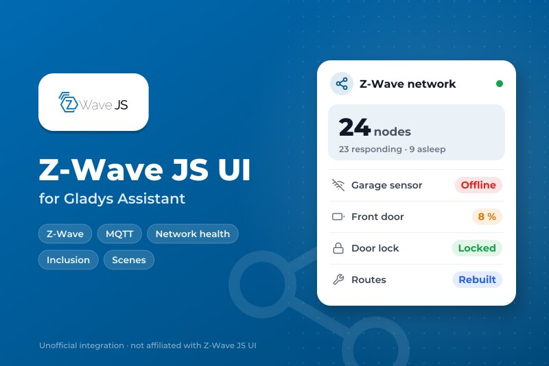
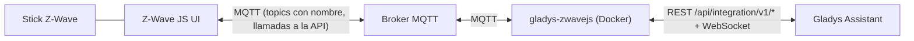
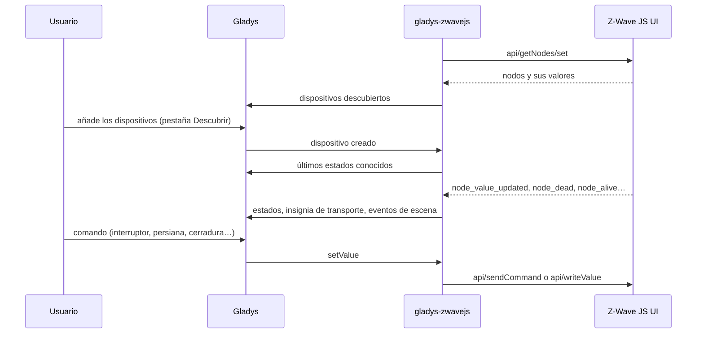
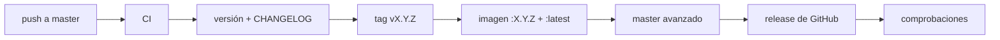

# Gladys Z-Wave JS UI

[English](README.md) | [Français](README.fr.md) | [Deutsch](README.de.md) | **Español**

[](LICENSE)
[](https://github.com/William-De71/gladys-zwavejs/releases)
[](https://github.com/William-De71/gladys-zwavejs/actions/workflows/release.yml)
[](https://gladysassistant.com)



Su red [Z-Wave JS UI](https://zwave-js.github.io/zwave-js-ui/) en Gladys Assistant, a través de MQTT: interruptores, reguladores, persianas, sensores, termostatos, radiadores de hilo piloto, luces de color, cerraduras, sirenas y puertas de garaje, además de un widget de estado de la red y escenas para hacer ping, reparar e incluir nodos.

> **Un fork, y una integración personal.** Este repositorio es un fork de [sescandell/gladys-zwavejs](https://github.com/sescandell/gladys-zwavejs) de Stéphane Escandell (Apache-2.0), publicado a su propio ritmo con las novedades marcadas como «fork» más abajo. No está en la tienda de Gladys (el repositorio no lleva, a propósito, el topic `gladys-assistant-integration`): instálelo desde la URL de este repositorio.

Documentación de usuario: [`docs/es.md`](docs/es.md) · [`docs/en.md`](docs/en.md). Ampliar la integración: [`AGENTS.md`](AGENTS.md) (en inglés).

## Funcionalidades

- **Dispositivos construidos a partir de las command classes Z-Wave**: interruptores binarios y multinivel (reguladores, persianas, hilo piloto del Qubino Flush Pilot), sensores binarios / de alarma / multinivel, notificaciones, contadores, botones Central Scene, baterías, termostatos (modo, consignas, estado de funcionamiento).
- **Más command classes** (fork): luces de color (Color Switch), cerraduras (Door Lock), sirenas (Sound Switch), puertas de garaje y portones (Barrier Operator), ventiladores de termostato (Thermostat Fan Mode).
- **Widget de panel «Red Z-Wave»** (fork): nodos, nodos que no responden, pilas bajas, nodos dormidos, lo que requiere su atención, y los botones **Actualizar** / **Reparar rutas**.
- **Disparadores de escena** (fork): un nodo deja de responder, vuelve a responder, se añade.
- **Acciones de escena** (fork): hacer ping a un nodo, releer sus valores, reconstruir las rutas de un nodo o de la red, ajustar un parámetro de configuración, iniciar o detener una inclusión o una exclusión.
- **Insignia de transporte** en cada dispositivo: nodo muerto, entrevista incompleta.
- **Migración idéntica** desde el servicio integrado de Gladys: mismos identificadores externos, verificados por el test golden.

## Cómo funciona





Z-Wave JS UI gestiona la radio y la administración de la red. Esta integración traduce lo que publica en dispositivos de Gladys, los comandos de Gladys en comandos Z-Wave, y le transmite algunas operaciones de red (ping, reconstrucción de rutas, inclusión) desde las escenas y el widget. A propósito, no reimplementa ninguna parte de zwave-js.

### Transporte

Solo `local`: la integración habla con su broker MQTT, nada sale de su red. Cada dispositivo lleva una insignia de transporte: **Inaccesible** cuando Z-Wave JS UI marca el nodo como muerto, **Degradado** mientras su entrevista no ha terminado.

### Estructura del proyecto

```
index.ts                        arranque del SDK + conexión de los callbacks, sin lógica
src/
  config.ts                     valores por defecto, broker y topics
  types/zwave.ts                formas de los mensajes de Z-Wave JS UI
  zwave/
    ZwaveJsUiClient.ts          enlace MQTT (reconexión idempotente)
    ZwaveApi.ts                 petición / respuesta sobre la API de zwave-js-ui
    NodeRegistry.ts             vista en memoria de la red
    topics.ts                   árbol de topics + suscripciones
    stateValues.ts              estados de Gladys que el SDK no exporta
    commandClasses/             UN MÓDULO POR COMMAND CLASS
  mapping/
    DeviceMapper.ts             nodos -> dispositivos, valores -> estados
    externalId.ts               construcción / lectura de los identificadores externos
    featureName.ts              nombres legibles de las funciones
    quirks.ts                   correcciones por dispositivo, cada una con su motivo
    transport.ts                estado del nodo -> insignia de transporte del dispositivo
    clean.ts                    normalización de los nombres
  runtime/
    ZwaveIntegration.ts         la integración en sí
    NetworkOperations.ts        las acciones de escena
    networkHealth.ts            vista general de la red + contenido del widget
    StatePublisher.ts           deduplicación, lotes, agrupación, presupuesto
    TransportPublisher.ts       insignia de transporte, solo cambios
    CommandDispatcher.ts        comando de Gladys -> mensaje MQTT
.github/scripts/release.mjs     versión, changelog, subida de versión (probado en test/)
```

**Un módulo por command class.** Un módulo reúne las tres facetas de cada propiedad: lo que **expone** como funciones de Gladys, cómo se **leen** sus valores (`fromZwave`) y cómo se **controla** (`toZwave`); declararlas juntas evita que diverjan. Las variantes elegidas según la clase de dispositivo están en `byDeviceClass`: un regulador (`17-1`) y un motor de persiana (`17-5/6/7`) hablan ambos Multilevel Switch, y `0` significa APAGADO para uno y PARADA para el otro. Cuando incluso la clase de dispositivo miente, `byProduct` elige una variante por producto (un módulo de hilo piloto se anuncia como regulador). Añadir una command class es un archivo y una línea en `commandClasses/index.ts`.

**Publicación de estados.** Gladys acepta 300 estados por minuto y por integración, 100 por petición, y una red Z-Wave informa más rápido que eso. `StatePublisher` descarta los estados de los dispositivos que el usuario no ha creado; descarta un valor idéntico al anterior, solo durante unos minutos (nunca un evento, como una pulsación de botón); agrupa en lotes y solo fusiona las medidas `sampled` (una persiana o un regulador conserva cada posición intermedia); y retiene la cola en lugar de superar el presupuesto.

**Control de los dispositivos.** Todo lo que necesita un comando viene del identificador externo de la función, del módulo de command class y de la categoría de la función, nunca de la caché de nodos, así que un comando funciona justo después de un reinicio. Los identificadores externos se guardan:

```
dispositivo : ext:<selector>:<nodeId>
función     : ext:<selector>:<nodeId>:<endpoint>:<cc>:<property>[:<propertyKey>][:<featureName>]
```

## Dispositivos y funciones

| Command class                   | Lo que obtiene en Gladys                                          |
| ------------------------------- | ----------------------------------------------------------------- |
| Binary Switch                   | interruptor encendido/apagado                                     |
| Multilevel Switch (regulador)   | brillo, encendido/apagado, «restaurar el anterior»                |
| Multilevel Switch (persiana)    | posición de la persiana, abrir/cerrar/parar                       |
| Multilevel Switch (hilo piloto) | modo de calefacción: apagado, antihielo, eco, confort…            |
| Binary Sensor / Alarm Sensor    | movimiento, humo, CO, CO₂, fuga, apertura, temperatura            |
| Notification                    | apertura de puerta/ventana, alarma de humo, alarma de CO          |
| Multilevel Sensor               | temperatura, iluminancia, potencia                                |
| Meter                           | energía, potencia, tensión, corriente                             |
| Central Scene                   | pulsaciones de botón (simple, doble, triple, mantenida, soltada)  |
| Battery                         | nivel e indicador de pila baja                                    |
| Thermostat Mode / Setpoint      | modo; consignas de calefacción, refrigeración y ahorro de energía |
| Thermostat Operating State      | en reposo, calentando, enfriando                                  |
| Thermostat Fan Mode (fork)      | velocidad del ventilador: auto, baja, media, alta, silencio       |
| Color Switch (fork)             | color RGB                                                         |
| Door Lock (fork)                | bloqueada / desbloqueada                                          |
| Sound Switch (fork)             | sirena encendida/apagada, una por endpoint                        |
| Barrier Operator (fork)         | puerta de garaje / portón: abrir/cerrar + sensor de apertura      |

Los detalles (hilo piloto, termostatos, cerraduras, puertas de garaje) están en la [documentación de usuario](docs/es.md).

## Disparadores, acciones de escena y widget

| Disparador   | Cuándo                                  | Variables          |
| ------------ | --------------------------------------- | ------------------ |
| `node_dead`  | Z-Wave JS UI marca un nodo como muerto  | node_id, node_name |
| `node_alive` | un nodo muerto vuelve a estar accesible | node_id, node_name |
| `node_added` | un dispositivo acaba de incluirse       | node_id, node_name |

Los dos primeros pueden limitarse a un dispositivo.

| Acción                     | Qué hace                                                 | Salidas            |
| -------------------------- | -------------------------------------------------------- | ------------------ |
| `ping_node`                | comprueba que el nodo responde                           | alive              |
| `refresh_values`           | vuelve a pedir todos sus valores al nodo                 | completed          |
| `rebuild_node_routes`      | repara el camino de un nodo al controlador               | completed, success |
| `rebuild_network_routes`   | inicia la reconstrucción de las rutas de todos los nodos | started            |
| `set_config_parameter`     | escribe un parámetro (número + valor)                    | completed, success |
| `start_inclusion`          | modo inclusión (por defecto o no segura)                 | started            |
| `start_exclusion`          | modo exclusión                                           | started            |
| `stop_inclusion_exclusion` | sale de ambos modos                                      | —                  |

Un nodo a pilas solo recibe una petición en su próximo despertar: la acción responde entonces `completed: false` en lugar de fallar, y la petición queda en cola en Z-Wave JS UI. Una inclusión segura S2 pide el PIN del dispositivo en Z-Wave JS UI.

El widget **Red Z-Wave** muestra cuatro contadores (nodos, no responden, pilas bajas, dormidos), la lista de lo que requiere su atención (cuánto tiempo lleva en silencio, nivel de pila, entrevista incompleta) y dos botones: **Actualizar** y **Reparar rutas** (con confirmación).

Ejemplos:

- **Cuando un nodo deja de responder** → enviarme «{{triggerEvent.data.node_name}} ya no responde».
- **Cada domingo a las 3:00** → reconstruir las rutas de la red.
- **Cuando se añade un nodo** → ajustar su parámetro de configuración 3 a 1.

## Requisitos previos

- Gladys Assistant **5.3.0** o posterior. Las instancias más antiguas no pueden instalar esta versión.
- [Z-Wave JS UI](https://zwave-js.github.io/zwave-js-ui/) con su pasarela MQTT activada, y un broker MQTT accesible para ambos.
- En Z-Wave JS UI, sección MQTT: **Name** `zwave-js-ui`, **Prefix** `zwave`. Sección Gateway: **Named topics**, **Entire Z-Wave value Object**, y **Send Z-Wave events**, **Include Node info** y **Publish node details** activados (capturas en la [documentación de usuario](docs/es.md)).

## Instalación

1. En Gladys: **Integraciones → Integraciones externas → instalar desde la URL de un repositorio**, y luego `https://github.com/William-De71/gladys-zwavejs`.
2. Modo desarrollador: construya la imagen en la máquina de Gladys (`docker build -t gladys-zwavejs .`) e instálela desde «Modo desarrollador: instalar desde una imagen Docker».

Si viene del servicio Z-Wave JS UI integrado en Gladys: los identificadores externos son los mismos, consulte «Migración» en la [documentación de usuario](docs/es.md).

## Configuración

| Campo               | Por defecto | Función                                |
| ------------------- | ----------- | -------------------------------------- |
| URL del broker MQTT | vacío       | `mqtt://host:1883`, protocolo incluido |
| Usuario MQTT        | vacío       | vacío para un broker anónimo           |
| Contraseña MQTT     | vacío       | guardada como secreto                  |

El botón **Probar la conexión** indica si el broker responde y cuántos nodos se conocen; **Registrar los dispositivos calculados** escribe en el registro lo que se envía a Gladys, para un informe de error.

## Uso

1. Guarde la configuración y luego pulse **Probar la conexión**.
2. Pestaña **Descubrir**: añada sus dispositivos Z-Wave.
3. Añada el widget **Red Z-Wave** a un panel y cree escenas con los disparadores y acciones anteriores.

## Desarrollo

Node 26 ejecuta directamente las fuentes TypeScript (eliminación nativa de tipos): **no hay paso de compilación** ni `dist/`. `tsc` solo sirve para comprobar los tipos, y la imagen incluye las fuentes tal como están escritas.

```bash
npm install
npm run typecheck             # tsc --noEmit
npm run lint                  # oxlint
npm run format:check          # oxfmt, como en la CI
npm test                      # node --test, volcados reales de getNodes, nunca la red
scripts/build-cover.sh        # cover.jpg a partir de cover.svg
node .github/scripts/release.mjs next   # la versión que recibiría la próxima release
```

Las pruebas usan mensajes `getNodes` reales (`test/fixtures/`). `test/golden.test.ts` convierte una red entera y la compara con la salida del servicio interno de Gladys: una diferencia deliberada se declara en ese archivo con su motivo, y la referencia nunca se regenera.

Contra un Gladys real: instale en modo desarrollador para obtener un token y luego `GLADYS_HOST_API_URL=http://localhost:1443 GLADYS_INTEGRATION_TOKEN=… GLADYS_INTEGRATION_SELECTOR=… npm start`.

## Publicación

Cada push a `master` publica una versión cuando sus Conventional Commits lo justifican (`feat` → menor, `fix` / `perf` → parche, cambio incompatible → mayor): CI, versión, `CHANGELOG.md` generado, tag, imagen multiarquitectura `ghcr.io/william-de71/gladys-zwavejs` (amd64 + arm64), luego `master`, la release de GitHub y una comprobación de que la imagen es pública y de que el topic de la tienda no está. `docs`, `chore`, `ci`, `test`, `style`, `refactor` y `build` por sí solos no publican nada. **Actions → Release → Run workflow** fuerza una versión (`release-as`) o muestra la siguiente sin publicar (`dry-run`).



Las versiones del repositorio original (hasta la 1.8.0) las publica sescandell. Las versiones de este fork empiezan en la 1.9.0; su propia 1.8.0, publicada por error con el número original, es el mismo código que la 1.9.0.

## Solución de problemas

- **Nada en la pestaña Descubrir**: compruebe el estado en la página de configuración y luego los ajustes de Z-Wave JS UI indicados arriba (Named topics, Entire Z-Wave value Object, Include Node info).
- **Un dispositivo con menos funciones de lo esperado**: su entrevista no ha terminado (insignia Degradado). Despierte el dispositivo a pilas o use la acción **Releer los valores de un nodo**.
- **Una acción de escena responde `completed: false`**: el nodo duerme; la petición espera a su próximo despertar.
- Registros: Configuración → Supervisión; `DEBUG=gladys-integration-sdk` para el SDK en modo desarrollador; el botón **Registrar los dispositivos calculados** para los datos completos del descubrimiento.

## Seguridad

Consulte [SECURITY.md](SECURITY.md). La integración guarda sus credenciales MQTT (almacenadas por Gladys como secreto) y puede iniciar una inclusión o una exclusión en su red: mantenga el broker en su red local.

## Licencia

[Apache-2.0](LICENSE). Obra original de Stéphane Escandell ([sescandell/gladys-zwavejs](https://github.com/sescandell/gladys-zwavejs)); consulte [NOTICE](NOTICE).
