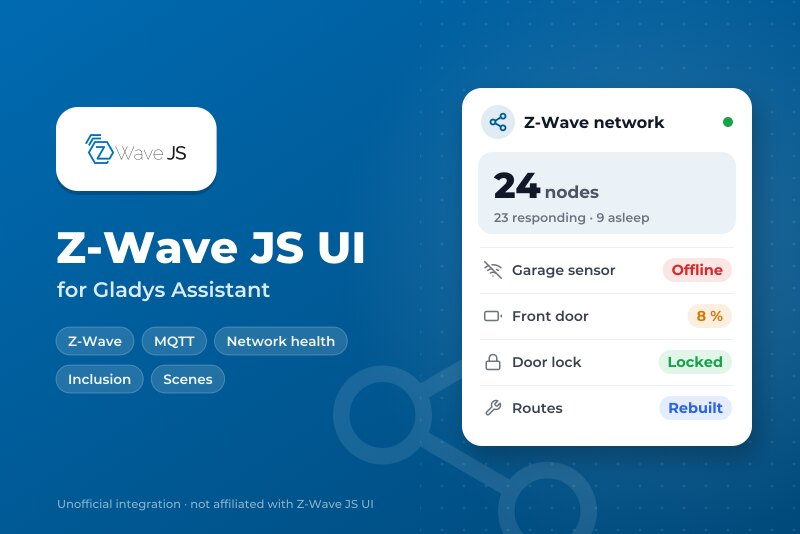
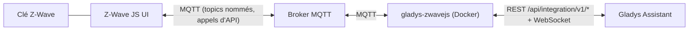
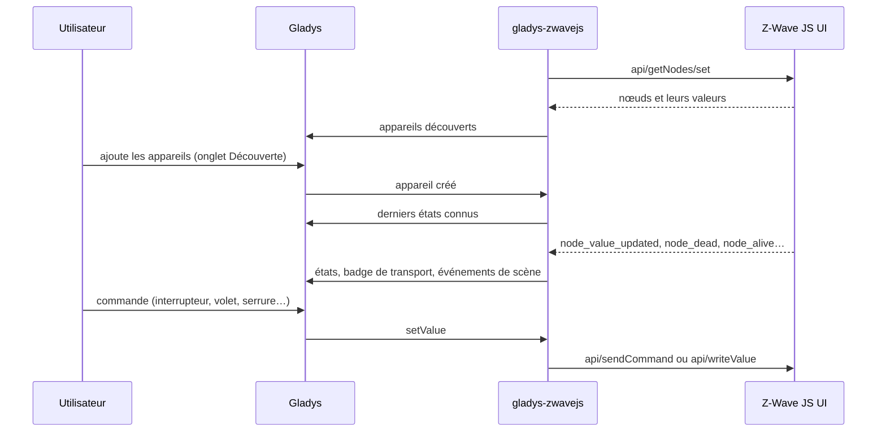
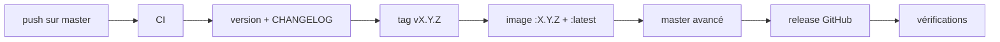

# Gladys Z-Wave JS UI

[English](README.md) | **Français** | [Deutsch](README.de.md) | [Español](README.es.md)

[](LICENSE)
[](https://github.com/William-De71/gladys-zwavejs/releases)
[](https://github.com/William-De71/gladys-zwavejs/actions/workflows/release.yml)
[](https://gladysassistant.com)



Votre réseau [Z-Wave JS UI](https://zwave-js.github.io/zwave-js-ui/) dans Gladys Assistant, via MQTT : interrupteurs, variateurs, volets, capteurs, thermostats, radiateurs fil pilote, lumières couleur, serrures, sirènes et portes de garage, plus un widget de santé du réseau et des scènes pour interroger, réparer et inclure des nœuds.

> **Un fork, et une intégration personnelle.** Ce dépôt est un fork de [sescandell/gladys-zwavejs](https://github.com/sescandell/gladys-zwavejs) de Stéphane Escandell (Apache-2.0), publié à son propre rythme avec les ajouts marqués « fork » ci-dessous. Il n'est pas dans le store Gladys (le dépôt ne porte volontairement pas le topic `gladys-assistant-integration`) : installez-le depuis l'URL de ce dépôt.

Documentation utilisateur : [`docs/fr.md`](docs/fr.md) · [`docs/en.md`](docs/en.md) · [`docs/de.md`](docs/de.md) · [`docs/es.md`](docs/es.md). Faire évoluer l'intégration : [`AGENTS.md`](AGENTS.md) (en anglais).

## Fonctionnalités

- **Appareils construits à partir des command classes Z-Wave** : interrupteurs on/off et multiniveaux (variateurs, volets, fil pilote du Qubino Flush Pilot), capteurs binaires / d'alarme / multiniveaux, notifications, compteurs, boutons Central Scene, piles, thermostats (mode, consignes, état de fonctionnement).
- **Command classes supplémentaires** (fork) : lumières couleur (Color Switch), serrures (Door Lock), sirènes (Sound Switch), portes de garage et portails (Barrier Operator), ventilation des thermostats (Thermostat Fan Mode).
- **Widget « Réseau Z-Wave »** (fork) : nœuds, nœuds qui ne répondent plus, piles faibles, nœuds endormis, ce qui demande votre attention, et les boutons **Actualiser** / **Réparer les routes**.
- **Déclencheurs de scène** (fork) : un nœud ne répond plus, répond de nouveau, est ajouté.
- **Actions de scène** (fork) : interroger un nœud, relire ses valeurs, reconstruire les routes d'un nœud ou du réseau, régler un paramètre de configuration, lancer ou arrêter une inclusion ou une exclusion.
- **Badge de transport** sur chaque appareil : nœud mort, interview incomplète.
- **Migration à l'identique** depuis le service intégré de Gladys : mêmes identifiants externes, vérifiés par le test golden.

## Fonctionnement





Z-Wave JS UI possède la radio et la gestion du réseau. Cette intégration transforme ce qu'il publie en appareils Gladys, les commandes Gladys en commandes Z-Wave, et lui relaie quelques opérations de réseau (interrogation, réparation des routes, inclusion) depuis les scènes et le widget. Elle ne réimplémente volontairement aucune partie de zwave-js.

### Transport

`local` uniquement : l'intégration parle à votre broker MQTT, rien ne sort de votre réseau. Chaque appareil porte un badge de transport : **injoignable** quand Z-Wave JS UI déclare le nœud mort, **dégradé** tant que son interview n'est pas terminée.

### Organisation du code

```
index.ts                        démarrage du SDK + branchement des callbacks, aucune logique
src/
  config.ts                     valeurs par défaut, broker et topics
  types/zwave.ts                formes des messages de Z-Wave JS UI
  zwave/
    ZwaveJsUiClient.ts          lien MQTT (reconnexion idempotente)
    ZwaveApi.ts                 requête / réponse sur l'API de zwave-js-ui
    NodeRegistry.ts             vue en mémoire du réseau
    topics.ts                   arbre des topics + abonnements
    stateValues.ts              états Gladys que le SDK n'exporte pas
    commandClasses/             UN MODULE PAR COMMAND CLASS
  mapping/
    DeviceMapper.ts             nœuds -> appareils, valeurs -> états
    externalId.ts               construction / lecture des identifiants externes
    featureName.ts              noms lisibles des fonctionnalités
    quirks.ts                   correctifs par appareil, chacun avec sa raison
    transport.ts                état du nœud -> badge de transport
    clean.ts                    normalisation des noms
  runtime/
    ZwaveIntegration.ts         l'intégration elle-même
    NetworkOperations.ts        les actions de scène
    networkHealth.ts            vue d'ensemble du réseau + contenu du widget
    StatePublisher.ts           déduplication, lots, regroupement, budget
    TransportPublisher.ts       badge de transport, changements seulement
    CommandDispatcher.ts        commande Gladys -> message MQTT
.github/scripts/release.mjs     version, changelog, montée de version (testé dans test/)
```

**Un module par command class.** Un module réunit les trois facettes de chaque propriété : ce qu'elle **expose** comme fonctionnalités Gladys, comment ses valeurs sont **lues** (`fromZwave`) et comment elle est **commandée** (`toZwave`) ; les déclarer ensemble les empêche de diverger. Les variantes choisies selon la classe d'appareil sont dans `byDeviceClass` : un variateur (`17-1`) et un moteur de volet (`17-5/6/7`) parlent tous deux Multilevel Switch, et `0` veut dire arrêt pour l'un, stop pour l'autre. Quand même la classe d'appareil se trompe, `byProduct` choisit une variante par produit (un module fil pilote se présente comme un variateur). Ajouter une command class, c'est un fichier et une ligne dans `commandClasses/index.ts`.

**Publication des états.** Gladys accepte 300 états par minute et par intégration, 100 par requête, et un réseau Z-Wave en produit davantage. `StatePublisher` écarte les états des appareils que l'utilisateur n'a pas créés ; écarte une valeur identique à la précédente, pendant quelques minutes seulement (jamais un événement, comme un appui de bouton) ; regroupe en lots et ne fusionne que les mesures `sampled` (un volet ou un variateur garde chaque position intermédiaire) ; et retient la file plutôt que de dépasser le budget.

**Commande des appareils.** Tout ce dont une commande a besoin vient de l'identifiant externe de la fonctionnalité, du module de command class et de la catégorie, jamais du cache des nœuds : une commande fonctionne dès le redémarrage. Les identifiants externes sont enregistrés :

```
appareil        : ext:<selector>:<nodeId>
fonctionnalité  : ext:<selector>:<nodeId>:<endpoint>:<cc>:<property>[:<propertyKey>][:<featureName>]
```

## Appareils et fonctionnalités

| Command class                  | Ce que vous obtenez dans Gladys                              |
| ------------------------------ | ------------------------------------------------------------ |
| Binary Switch                  | interrupteur on/off                                          |
| Multilevel Switch (variateur)  | luminosité, on/off, « restaurer l'état précédent »           |
| Multilevel Switch (volet)      | position du volet, ouvrir/fermer/stop                        |
| Multilevel Switch (fil pilote) | mode de chauffage : arrêt, hors-gel, éco, confort…           |
| Binary Sensor / Alarm Sensor   | mouvement, fumée, CO, CO₂, fuite, ouverture, température     |
| Notification                   | ouverture de porte/fenêtre, alarme fumée, alarme CO          |
| Multilevel Sensor              | température, luminosité, puissance                           |
| Meter                          | énergie, puissance, tension, courant                         |
| Central Scene                  | appuis de bouton (simple, double, triple, maintenu, relâché) |
| Battery                        | niveau et indicateur de pile faible                          |
| Thermostat Mode / Setpoint     | mode ; consignes de chauffage, de climatisation et d'éco     |
| Thermostat Operating State     | au repos, en chauffe, en refroidissement                     |
| Thermostat Fan Mode (fork)     | ventilation : auto, basse, moyenne, haute, silence           |
| Color Switch (fork)            | couleur RGB                                                  |
| Door Lock (fork)               | verrouillée / déverrouillée                                  |
| Sound Switch (fork)            | sirène on/off, une par endpoint                              |
| Barrier Operator (fork)        | porte de garage / portail : ouvrir/fermer + capteur          |

Les détails (fil pilote, thermostats, serrures, portes de garage) sont dans la [documentation utilisateur](docs/fr.md).

## Déclencheurs, actions de scène et widget

| Déclencheur  | Quand                                    | Variables          |
| ------------ | ---------------------------------------- | ------------------ |
| `node_dead`  | Z-Wave JS UI déclare un nœud mort        | node_id, node_name |
| `node_alive` | un nœud déclaré mort redevient joignable | node_id, node_name |
| `node_added` | un appareil vient d'être inclus          | node_id, node_name |

Les deux premiers peuvent être limités à un appareil.

| Action                     | Effet                                         | Sorties            |
| -------------------------- | --------------------------------------------- | ------------------ |
| `ping_node`                | vérifie que le nœud répond                    | alive              |
| `refresh_values`           | redemande toutes ses valeurs au nœud          | completed          |
| `rebuild_node_routes`      | répare le chemin d'un nœud vers le contrôleur | completed, success |
| `rebuild_network_routes`   | lance la reconstruction de toutes les routes  | started            |
| `set_config_parameter`     | écrit un paramètre (numéro + valeur)          | completed, success |
| `start_inclusion`          | mode inclusion (par défaut ou non sécurisée)  | started            |
| `start_exclusion`          | mode exclusion                                | started            |
| `stop_inclusion_exclusion` | quitte les deux modes                         | —                  |

Un nœud sur pile ne reçoit une demande qu'à son prochain réveil : l'action répond alors `completed: false` au lieu d'échouer, et la demande reste en attente dans Z-Wave JS UI. Une inclusion sécurisée S2 demande le code PIN de l'appareil dans Z-Wave JS UI.

Le widget **Réseau Z-Wave** affiche quatre compteurs (nœuds, ne répondent plus, piles faibles, endormis), la liste de ce qui demande votre attention (muet depuis combien de temps, niveau de pile, interview incomplète) et deux boutons : **Actualiser** et **Réparer les routes** (après confirmation).

Exemples :

- **Quand un nœud ne répond plus** → m'envoyer « {{triggerEvent.data.node_name}} ne répond plus ».
- **Chaque dimanche à 3 h** → reconstruire les routes du réseau.
- **Quand un nœud est ajouté** → régler son paramètre de configuration 3 à 1.

## Prérequis

- Gladys Assistant **5.3.0** ou plus récent. Les instances plus anciennes ne peuvent pas installer cette version.
- [Z-Wave JS UI](https://zwave-js.github.io/zwave-js-ui/) avec sa passerelle MQTT activée, et un broker MQTT joignable par les deux.
- Dans Z-Wave JS UI, section MQTT : **Name** `zwave-js-ui`, **Prefix** `zwave`. Section Gateway : **Named topics**, **Entire Z-Wave value Object**, et **Send Z-Wave events**, **Include Node info** et **Publish node details** activés (captures dans la [documentation utilisateur](docs/fr.md)).

## Installation

1. Dans Gladys : **Intégrations → Intégrations externes → installer depuis l'URL d'un dépôt**, puis `https://github.com/William-De71/gladys-zwavejs`.
2. Mode développeur : construisez l'image sur la machine de Gladys (`docker build -t gladys-zwavejs .`) et installez-la depuis « Mode développeur : installer depuis une image Docker ».

Vous venez du service Z-Wave JS UI intégré à Gladys : les identifiants externes sont les mêmes, voir « Migrer » dans la [documentation utilisateur](docs/fr.md).

## Configuration

| Champ              | Défaut | Rôle                                  |
| ------------------ | ------ | ------------------------------------- |
| URL du broker MQTT | vide   | `mqtt://hote:1883`, protocole compris |
| Utilisateur MQTT   | vide   | vide pour un broker anonyme           |
| Mot de passe MQTT  | vide   | conservé comme secret                 |

Le bouton **Tester la connexion** dit si le broker répond et combien de nœuds sont connus ; **Journaliser les appareils calculés** écrit dans le journal ce qui est envoyé à Gladys, pour un rapport de bug.

## Utilisation

1. Enregistrez la configuration, puis **Tester la connexion**.
2. Onglet **Découverte** : ajoutez vos appareils Z-Wave.
3. Ajoutez le widget **Réseau Z-Wave** sur un tableau de bord, écrivez des scènes avec les déclencheurs et actions ci-dessus.

## Développement

Node 26 exécute directement les sources TypeScript (suppression native des types) : **pas d'étape de build**, pas de `dist/`. `tsc` ne sert qu'à vérifier les types, et l'image embarque les sources telles quelles.

```bash
npm install
npm run typecheck             # tsc --noEmit
npm run lint                  # oxlint
npm run format:check          # oxfmt, comme en CI
npm test                      # node --test, vrais dumps getNodes, jamais le réseau
scripts/build-cover.sh        # cover.jpg depuis cover.svg
node .github/scripts/release.mjs next   # la version que prendrait la prochaine release
```

Les tests utilisent de vrais messages `getNodes` (`test/fixtures/`). `test/golden.test.ts` convertit un réseau entier et le compare à la sortie du service intégré de Gladys : un écart voulu est déclaré dans ce fichier avec sa raison, et la référence n'est jamais régénérée.

Contre un vrai Gladys : installez en mode développeur pour obtenir un jeton, puis `GLADYS_HOST_API_URL=http://localhost:1443 GLADYS_INTEGRATION_TOKEN=… GLADYS_INTEGRATION_SELECTOR=… npm start`.

## Publication

Chaque push sur `master` publie une version quand ses Conventional Commits le justifient (`feat` → mineure, `fix` / `perf` → corrective, rupture → majeure) : CI, version, `CHANGELOG.md` généré, tag, image multi-architecture `ghcr.io/william-de71/gladys-zwavejs` (amd64 + arm64), puis `master`, la release GitHub, et une vérification que l'image est publique et que le topic du store est absent. `docs`, `chore`, `ci`, `test`, `style`, `refactor` et `build` seuls ne publient rien. **Actions → Release → Run workflow** force une version (`release-as`) ou affiche la suivante sans rien publier (`dry-run`).



Les versions jusqu'à 1.8.0 ont été publiées par le dépôt d'origine ; ce fork reprend à partir de là.

## En cas de problème

- **Rien dans l'onglet Découverte** : vérifiez l'état sur la page de configuration, puis les réglages de Z-Wave JS UI ci-dessus (topics nommés, objet valeur complet, infos des nœuds).
- **Un appareil avec moins de fonctionnalités que prévu** : son interview n'est pas terminée (badge dégradé). Réveillez l'appareil sur pile, ou utilisez l'action **Relire les valeurs d'un nœud**.
- **Une action de scène répond `completed: false`** : le nœud dort ; la demande attend son prochain réveil.
- Journaux : Paramètres → Supervision ; `DEBUG=gladys-integration-sdk` pour le SDK en mode développeur ; le bouton **Journaliser les appareils calculés** pour la découverte complète.

## Sécurité

Voir [SECURITY.md](SECURITY.md). L'intégration détient vos identifiants MQTT (conservés par Gladys comme secret) et peut lancer une inclusion ou une exclusion sur votre réseau : gardez le broker sur votre réseau local.

## Licence

[Apache-2.0](LICENSE). Œuvre originale de Stéphane Escandell ([sescandell/gladys-zwavejs](https://github.com/sescandell/gladys-zwavejs)) ; voir [NOTICE](NOTICE).
