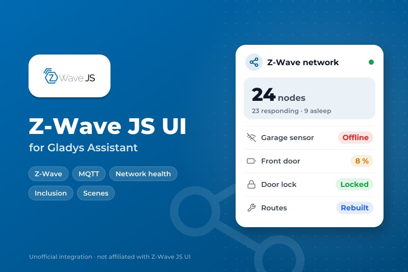
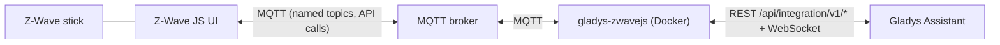
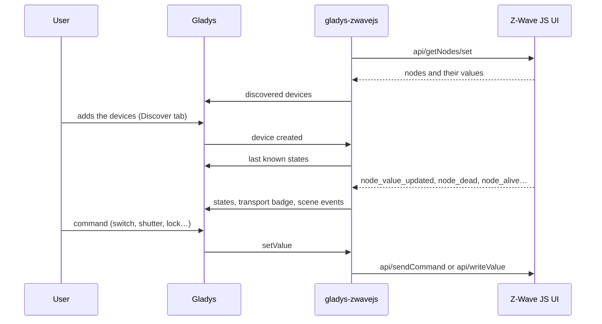
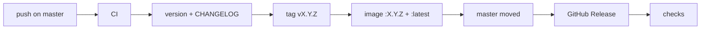

# Gladys Z-Wave JS UI

**English** | [Français](README.fr.md) | [Deutsch](README.de.md) | [Español](README.es.md)

[](LICENSE)
[](https://github.com/William-De71/gladys-zwavejs/releases)
[](https://github.com/William-De71/gladys-zwavejs/actions/workflows/release.yml)
[](https://gladysassistant.com)



Your [Z-Wave JS UI](https://zwave-js.github.io/zwave-js-ui/) network in Gladys Assistant, over MQTT: switches, dimmers, shutters, sensors, thermostats, pilot wire heaters, colour lights, locks, sirens and garage doors, plus a network health widget and scenes to ping, repair and include nodes.

> **A fork, and a personal integration.** This repository is a fork of [sescandell/gladys-zwavejs](https://github.com/sescandell/gladys-zwavejs) by Stéphane Escandell (Apache-2.0), released on its own schedule with the additions marked "fork" below. It is not in the Gladys store (the repository does not carry the `gladys-assistant-integration` topic, on purpose): install it from the URL of this repository.

User documentation: [`docs/en.md`](docs/en.md) · [`docs/fr.md`](docs/fr.md) · [`docs/de.md`](docs/de.md) · [`docs/es.md`](docs/es.md). Extending the integration: [`AGENTS.md`](AGENTS.md).

## Features

- **Devices built from the Z-Wave command classes**: binary and multilevel switches (dimmers, window coverings, Qubino Flush Pilot pilot wire), binary / alarm / multilevel sensors, notifications, meters, Central Scene buttons, batteries, thermostats (mode, setpoints, operating state).
- **More command classes** (fork): colour lights (Color Switch), door locks (Door Lock), sirens (Sound Switch), garage doors and gates (Barrier Operator), thermostat fans (Thermostat Fan Mode).
- **"Z-Wave network" dashboard widget** (fork): nodes, nodes not responding, low batteries, sleeping nodes, what needs attention, and the **Refresh** / **Rebuild routes** buttons.
- **Scene triggers** (fork): a node stops responding, responds again, is added.
- **Scene actions** (fork): ping a node, refresh its values, rebuild the routes of a node or of the network, set a configuration parameter, start or stop an inclusion or an exclusion.
- **Transport badge** on every device: dead node, interview not complete.
- **One-to-one migration** from the built-in Gladys service: same external ids, asserted by the golden test.

## How it works





Z-Wave JS UI owns the radio and the network management. This integration maps what it publishes onto Gladys devices, Gladys commands back onto Z-Wave commands, and relays a few network operations (ping, route rebuild, inclusion) from the scenes and the widget. It deliberately does not reimplement any part of zwave-js.

### Transport

`local` only: the integration talks to your MQTT broker, nothing leaves your network. Each device carries a transport badge: **unreachable** when Z-Wave JS UI marks the node dead, **degraded** while its interview is not complete.

### Project layout

```
index.ts                        SDK bootstrap + callback wiring, no logic
src/
  config.ts                     defaults, broker and topic resolution
  types/zwave.ts                shapes of the Z-Wave JS UI payloads
  zwave/
    ZwaveJsUiClient.ts          MQTT link (idempotent reconnection)
    ZwaveApi.ts                 request / response over the zwave-js-ui API
    NodeRegistry.ts             in-memory view of the network
    topics.ts                   topic tree + subscriptions
    stateValues.ts              Gladys state enums the SDK does not export
    commandClasses/             ONE MODULE PER COMMAND CLASS
  mapping/
    DeviceMapper.ts             nodes -> devices, values -> states
    externalId.ts               build/parse of the external ids
    featureName.ts              human-readable feature names
    quirks.ts                   per-device fixes, each with its reason
    transport.ts                node status -> device transport badge
    clean.ts                    name normalization
  runtime/
    ZwaveIntegration.ts         the integration itself
    NetworkOperations.ts        the scene actions
    networkHealth.ts            network overview + widget content
    StatePublisher.ts           dedup, batching, coalescing, budget
    TransportPublisher.ts       transport badge, changes only
    CommandDispatcher.ts        Gladys command -> MQTT message
.github/scripts/release.mjs     version, changelog, bump (tested in test/)
```

**One module per command class.** A module gathers the three facets of each property: what it **exposes** as Gladys features, how its values are **read** (`fromZwave`) and how it is **commanded** (`toZwave`); declaring them together keeps them from drifting apart. Variants selected by the device class live in `byDeviceClass`: a dimmer (`17-1`) and a window covering motor (`17-5/6/7`) both speak Multilevel Switch, and `0` is OFF for one, STOP for the other. When even the device class lies, `byProduct` selects a variant by product (a pilot wire module announces a dimmer). Adding a command class is one file and one line in `commandClasses/index.ts`.

**Publishing states.** Gladys accepts 300 states per minute per integration, 100 per request, and a Z-Wave network reports faster than that. `StatePublisher` drops the states of devices the user has not created; drops a value identical to the last one, for a few minutes only (never an event, such as a button press); batches, and coalesces only the `sampled` measurements (a shutter or a dimmer keeps every intermediate position); and holds the queue back rather than overrunning the budget.

**Commanding devices.** Everything a command needs comes from the feature external id, the command class module and the feature category, never from the node cache, so a command works right after a restart. External ids are persisted:

```
device  : ext:<selector>:<nodeId>
feature : ext:<selector>:<nodeId>:<endpoint>:<cc>:<property>[:<propertyKey>][:<featureName>]
```

## Devices and features

| Command class                  | What you get in Gladys                                |
| ------------------------------ | ----------------------------------------------------- |
| Binary Switch                  | on/off switch                                         |
| Multilevel Switch (dimmer)     | brightness, on/off, "restore previous"                |
| Multilevel Switch (covering)   | shutter position, open/close/stop                     |
| Multilevel Switch (pilot wire) | heater mode: off, frost protection, eco, comfort…     |
| Binary Sensor / Alarm Sensor   | motion, smoke, CO, CO₂, leak, opening, temperature    |
| Notification                   | door/window opening, smoke alarm, CO alarm            |
| Multilevel Sensor              | temperature, illuminance, power                       |
| Meter                          | energy, power, voltage, current                       |
| Central Scene                  | button clicks (single, double, triple, hold, release) |
| Battery                        | level and low-battery flag                            |
| Thermostat Mode / Setpoint     | mode; heating, cooling and energy-save setpoints      |
| Thermostat Operating State     | idle, heating, cooling                                |
| Thermostat Fan Mode (fork)     | fan speed: auto, low, medium, high, quiet             |
| Color Switch (fork)            | RGB colour                                            |
| Door Lock (fork)               | locked / unlocked                                     |
| Sound Switch (fork)            | siren on/off, one per endpoint                        |
| Barrier Operator (fork)        | garage door / gate: open/close + opening sensor       |

The details (pilot wire, thermostats, locks, garage doors) are in the [user documentation](docs/en.md).

## Scene triggers, actions and widget

| Trigger      | When                              | Variables          |
| ------------ | --------------------------------- | ------------------ |
| `node_dead`  | Z-Wave JS UI marks a node as dead | node_id, node_name |
| `node_alive` | a dead node is reachable again    | node_id, node_name |
| `node_added` | a device was just included        | node_id, node_name |

The first two can be limited to one device.

| Action                     | Does                                        | Outputs            |
| -------------------------- | ------------------------------------------- | ------------------ |
| `ping_node`                | checks the node answers                     | alive              |
| `refresh_values`           | asks the node for all its values again      | completed          |
| `rebuild_node_routes`      | repairs how one node reaches the controller | completed, success |
| `rebuild_network_routes`   | starts a route rebuild of every node        | started            |
| `set_config_parameter`     | writes a parameter (number + value)         | completed, success |
| `start_inclusion`          | inclusion mode (default or insecure)        | started            |
| `start_exclusion`          | exclusion mode                              | started            |
| `stop_inclusion_exclusion` | leaves both modes                           | —                  |

A battery node only gets a request at its next wake-up: the action then answers `completed: false` instead of failing, and the request stays queued in Z-Wave JS UI. A secure S2 inclusion asks for the device PIN in Z-Wave JS UI.

The **Z-Wave network** widget shows four counters (nodes, not responding, low batteries, asleep), the list of what needs attention (silent for how long, battery level, interview not complete) and two buttons: **Refresh** and **Rebuild routes** (with a confirmation).

Examples:

- **When a node stops responding** → send me "{{triggerEvent.data.node_name}} no longer responds".
- **Every Sunday at 3:00** → rebuild the routes of the network.
- **When a node is added** → set its configuration parameter 3 to 1.

## Prerequisites

- Gladys Assistant **5.3.0** or later. Older instances cannot install this version.
- [Z-Wave JS UI](https://zwave-js.github.io/zwave-js-ui/) with its MQTT gateway enabled, and an MQTT broker both can reach.
- In Z-Wave JS UI, MQTT section: **Name** `zwave-js-ui`, **Prefix** `zwave`. Gateway section: **Named topics**, **Entire Z-Wave value Object**, and **Send Z-Wave events**, **Include Node info** and **Publish node details** enabled (screenshots in the [user documentation](docs/en.md)).

## Installation

1. In Gladys: **Integrations → External integrations → install from a repository URL**, then `https://github.com/William-De71/gladys-zwavejs`.
2. Developer mode: build the image on the Gladys machine (`docker build -t gladys-zwavejs .`) and install it from "Developer mode: install from a Docker image".

Coming from the built-in Z-Wave JS UI service of Gladys: the external ids are the same, see "Migrating" in the [user documentation](docs/en.md).

## Configuration

| Field           | Default | Role                                  |
| --------------- | ------- | ------------------------------------- |
| MQTT broker URL | empty   | `mqtt://host:1883`, protocol included |
| MQTT username   | empty   | empty for an anonymous broker         |
| MQTT password   | empty   | stored as a secret                    |

The **Test the connection** button says whether the broker answers and how many nodes are known; **Log the computed devices** writes what Gladys is sent to the journal, for a bug report.

## Usage

1. Save the configuration, then **Test the connection**.
2. **Discover** tab: add your Z-Wave devices.
3. Add the **Z-Wave network** widget on a dashboard, write scenes with the triggers and actions above.

## Development

Node 26 runs the TypeScript sources directly (native type stripping): there is **no build step** and no `dist/`. `tsc` is only a type checker, and the image ships the sources as written.

```bash
npm install
npm run typecheck             # tsc --noEmit
npm run lint                  # oxlint
npm run format:check          # oxfmt, as the CI runs it
npm test                      # node --test, real getNodes dumps, never the network
scripts/build-cover.sh        # cover.jpg from cover.svg
node .github/scripts/release.mjs next   # the version the next release would get
```

Tests run against real `getNodes` payloads (`test/fixtures/`). `test/golden.test.ts` maps a whole network and compares it to the output of the internal Gladys service: a deliberate difference is declared in that file with its reason, and the reference is never regenerated.

Run against a real Gladys: install in developer mode to get a token, then `GLADYS_HOST_API_URL=http://localhost:1443 GLADYS_INTEGRATION_TOKEN=… GLADYS_INTEGRATION_SELECTOR=… npm start`.

## Release

Every push on `master` releases when its Conventional Commits deserve it (`feat` → minor, `fix` / `perf` → patch, breaking → major): CI, version, `CHANGELOG.md` generated, tag, multi-arch image `ghcr.io/william-de71/gladys-zwavejs` (amd64 + arm64), then `master`, the GitHub Release, and a check that the image is public and that the store topic is absent. `docs`, `chore`, `ci`, `test`, `style`, `refactor` and `build` alone release nothing. **Actions → Release → Run workflow** forces a version (`release-as`) or shows the next one without publishing (`dry-run`).



Upstream versions (up to 1.8.0) are released by sescandell. This fork's releases start at 1.9.0; its own 1.8.0, published by mistake under the upstream number, is the same code as 1.9.0.

## Troubleshooting

- **Nothing in the Discover tab**: check the status on the configuration page, then the Z-Wave JS UI settings above (named topics, entire value object, node info).
- **A device with fewer features than expected**: its interview is not complete (degraded badge). Wake a battery device up, or use the **Refresh the values of a node** action.
- **A scene action answers `completed: false`**: the node sleeps; the request waits for its next wake-up.
- Logs: Settings → Supervision; `DEBUG=gladys-integration-sdk` for the SDK in developer mode; the **Log the computed devices** button for the full discovery payload.

## Security

See [SECURITY.md](SECURITY.md). The integration holds your MQTT credentials (stored by Gladys as a secret) and can start an inclusion or an exclusion on your network: keep the broker on your local network.

## License

[Apache-2.0](LICENSE). Original work by Stéphane Escandell ([sescandell/gladys-zwavejs](https://github.com/sescandell/gladys-zwavejs)); see [NOTICE](NOTICE).
